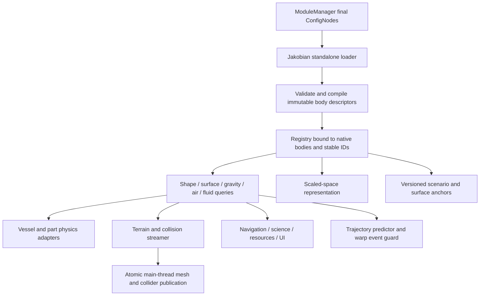

# System architecture and ownership

Status: proposed design, with the small analytic core described separately in the environment guide.

## Standalone loader and one world model

**Jakobian owns system loading from the first loader milestone.** Its own parser consumes final ModuleManager-patched `Jakobian { Body { ... } }` definitions, compiles immutable descriptors, constructs the native `PSystem` prefab and binds descriptors to spawned `CelestialBody` instances. It runs with Kopernicus absent. Kopernicus's pinned source provides implementation references and potentially reusable code with preserved provenance; its DLL is not a required loader dependency.

Preserve stock bodies and use native spherical PQS/orbit/environment machinery where appropriate, under Jakobian's own construction and configuration ownership. General geometry uses Jakobian providers. Stock `Radius` remains an explicitly documented compatibility/reference radius, never rewritten every tick to pretend to be local terrain height. A shape-aware body's scale, bounds and environment are computed by providers.

**Optional Kopernicus compatibility is separate from core loading.** Import familiar configuration through Jakobian's own normalization/parser layer and adapt supported external providers. When both mods are installed, a version-tested ownership coordinator must prevent competing prefab injection and duplicate runtime services. Jakobian remains the system loader. Until that coordination is implemented and validated, report an explicit loader conflict before system publication. Preserving node spelling or having both DLLs boot together is not full compatibility.

Standalone operation is a project requirement, not a later alternative. Spherical feature parity must be implemented and tested within Jakobian; it is not inherited by requiring Kopernicus. See the [standalone loader specification](standalone-loader.md) for lifecycle, source reuse and coexistence responsibilities.

## Assembly boundaries

| Component | Responsibilities | Game dependency |
| --- | --- | --- |
| `Jakobian.Core` | double math, immutable descriptors, chart topology, field evaluation and deterministic generation | None; `netstandard2.0` and `net472` prototype |
| `Jakobian` / KSP host | lifecycle, native body binding, coordinate conversion, terrain scheduling, scoped stock adapters | KSP/Unity `net472`; diagnostic scaffold exists |
| `Jakobian.Loader` | own ConfigNode parser, stock templates, descriptor compilation, native prefab construction and post-spawn fixups | Future KSP host component; no Kopernicus assembly dependency |
| `Jakobian.Compatibility.Kopernicus` | legacy config/provider interoperability and coordinated single-loader ownership | Future optional adapter; core loading works without it or Kopernicus |
| `Jakobian.Rendering` | chart meshes, scaled geometry, material/light/air/fluid providers | Future Unity host; shader assets built with Unity 2019.4.18f1 |
| `Jakobian.Compatibility.*` | third-party API/version-specific adapters | Future optional assemblies; absent dependencies must not prevent host load |
| inspection/validation tools | author diagnostics, asset validation, metadata inspection, offline baking | Modern .NET/Python, never game runtime dependencies |

Do not ship a modern .NET console binary as a KSP plugin. Core API and save-schema versions are separate from product versions. No public stable ABI is promised by this experimental scaffold.

## Runtime data flow

One immutable query context carries body ID, epoch, body-local pose, selected surface, generator version and availability/error bounds. A vessel's environment is sampled coherently per physics tick; per-part queries use their own location when needed. Publishing a centre-of-mass pressure as every part's pressure is an approximation with declared spatial tolerance.

Provide a fast allocation-free `TryGetBodyContext` for non-Jakobian vessels. Broad-phase spatial bounds determine possible surfaces/volumes; exact providers narrow those candidates. Queries may return multiple intersections, ambiguity, missing streamed data or no relevant surface. Never convert these to a fabricated zero altitude.

## Frames and transitions

Canonical state uses double-precision body-relative or host-relative inertial coordinates and universal time. Physics charts subtract a local origin **before** conversion to Unity float positions. Surface anchors store chart/material coordinates plus offset, not last-frame Unity transforms. Scaled-space geometry is generated and projected independently from contact chunks.

A frame manager controls the one loaded physics scene. It can track multiple vessels/parts in that frame, including decoupled debris and EVA. A disconnected distant vessel may use an independent unloaded numerical state, but cannot acquire an incompatible loaded rotating frame merely because it is selected. Cross-frame docking, close encounters between two rotating habitats and SOI transitions require explicit reconciliation and acceptance tests.

Transition order: predict boundary crossing -> prepare required collision footprint -> snapshot inertial state -> choose new chart -> transform every affected object's pose and velocity -> update caches -> enable contacts -> release obsolete coverage. Any unavailable critical step prevents unsafe entry/warp and reports a diagnostic. It must not silently delete vessels or invent braking.

## Capability registration

Extensions declare provider ID/version, geometry families, supported query kinds, thread safety, deterministic generation version, units and conservative bounds. Each body declares required capabilities. Reject a body with unmet required collision/physics capabilities before it can be visited. Optional graphics providers may degrade with a clear status; missing core shape providers cannot reinterpret existing saves as spheres.

Only one provider owns each body/service role. Composite gravity/fluid definitions are constructed deliberately by a single coordinator; they are not accidental sums of independently installed physics patches. Native stock caches are a compatibility view, not authoritative world state.

## Failure handling

Validate descriptors before native publication. Keep diagnostics tied to file/node path, body ID and provider. Cache repeated validation failures; limit identical runtime log entries. Audit Harmony patch owners and method signatures for the actual installed versions. If contact or force ownership is unresolved, disable visits to that specific arbitrary body and preserve its saved data. Do not disable unrelated spherical worlds or install a second global integrator to recover from an incompatibility.
